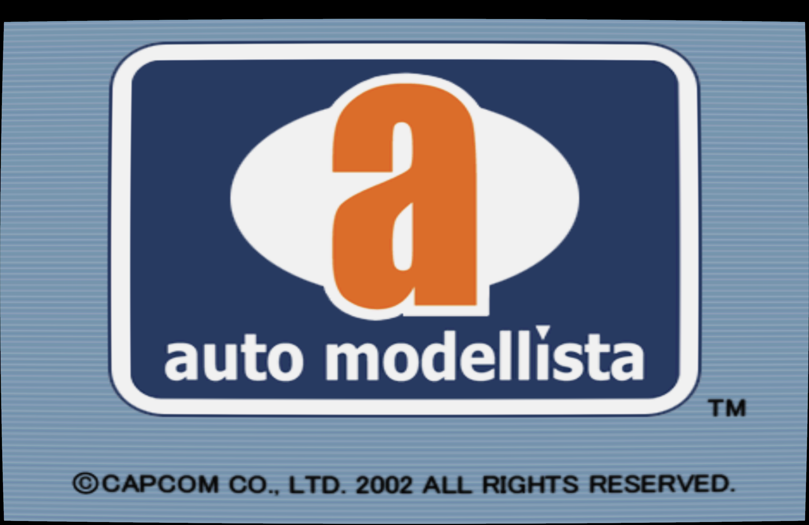
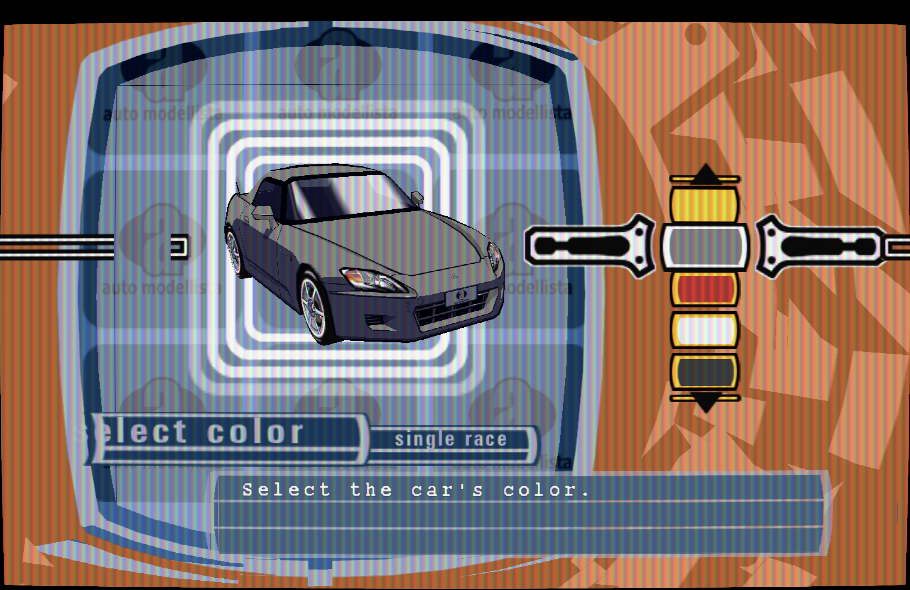
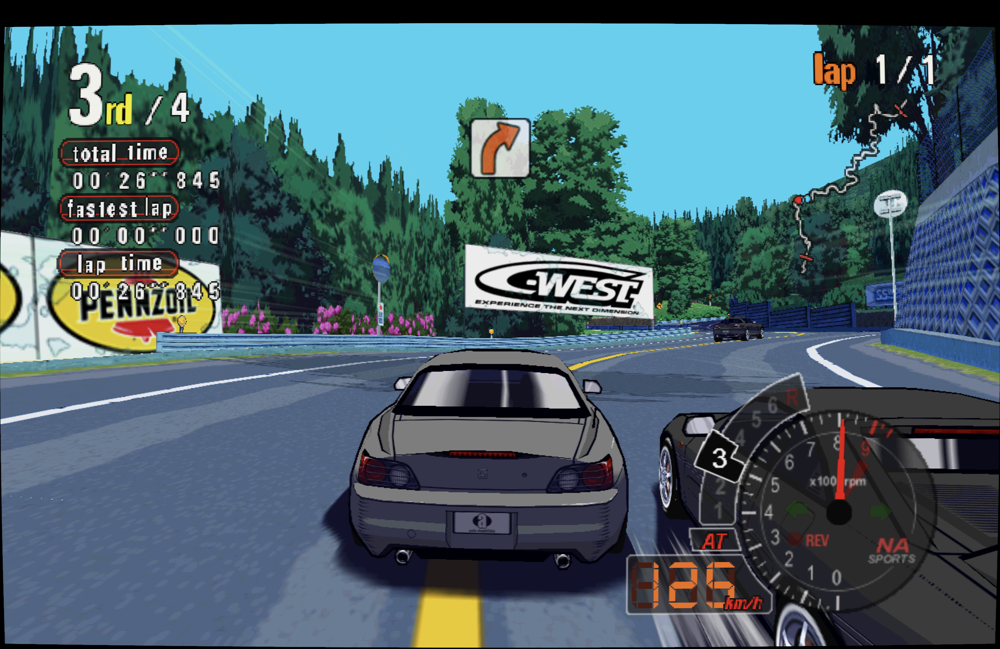
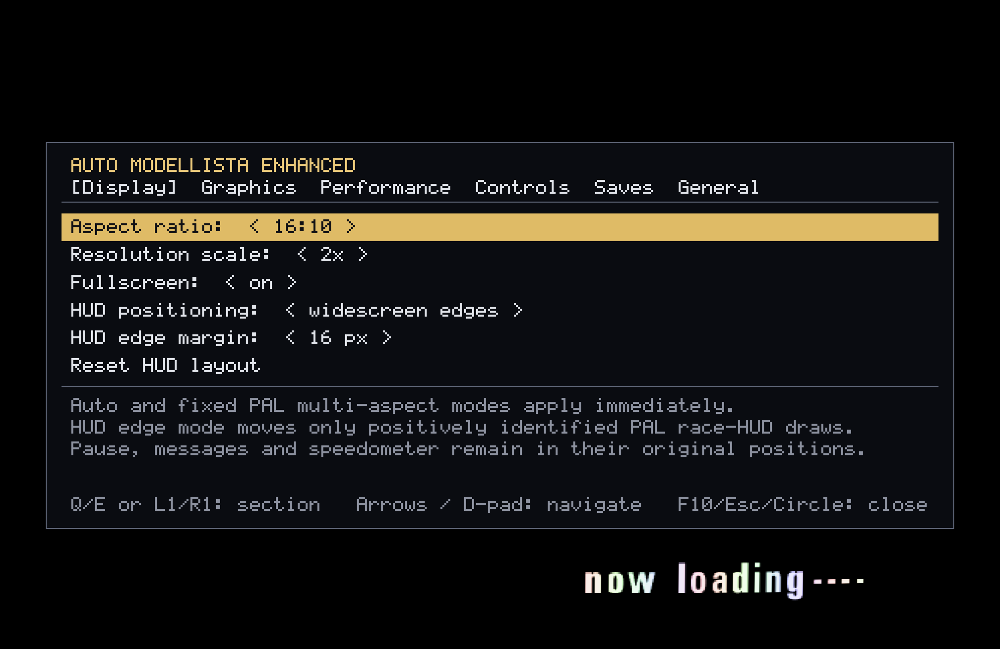

# Auto Modellista Enhanced

**Auto Modellista Enhanced** is a native, enhanced port of Capcom's PAL
PlayStation 2 release of *Auto Modellista* (`SLES-51191`). It currently targets
Apple Silicon macOS, with Windows support planned.

The project preserves the game's distinctive cel-shaded presentation while
adding modern display options, configurable post-processing, and a native
desktop runtime. This repository contains source code only; you must provide
your own legally obtained PAL game files.

## Features

The following enhancements are implemented, although validation across the
entire game, every display mode, and all hardware configurations is ongoing:

- Native Apple Silicon execution
- 4:3, 16:9, 16:10, and 21:9 aspect ratios, plus experimental 32:9 support
- Corrected HUD proportions, with optional widescreen HUD edge anchoring
- CRT-Lottes Fast, CRT-Lottes, and CRT-Hyllian post-processing
- AMD FidelityFX Contrast Adaptive Sharpening (CAS)
- Enhanced graphics settings through the controller-friendly F10 menu
- F3 performance overlay
- Controller and keyboard configuration
- Virtual PS2 memory-card support
- Quick saves and normal in-game saves
- Persistent graphics preferences
- Internal resolution scaling from 1x to 4x

An M1 Pro has been observed running the game at 2x internal resolution and
60 FPS. Higher internal resolutions can be slower, depending on the scene and
hardware. This is an observed result, not a guarantee of equivalent performance
throughout the game.

## Screenshots

### Title Screen and Car Selection

| Title Screen | Car Selection |
|:---:|:---:|
|  |  |

### 16:10 Widescreen Gameplay with CRT Effects



### Enhanced Graphics Frontend

| Display and HUD Settings | Graphics and CRT Settings |
|:---:|:---:|
|  |  |

## Installation and requirements

You need an Apple Silicon Mac with Xcode Command Line Tools, Git, CMake, Ninja,
Python 3, SDL2 development files, and Bash 4 or newer. With
[Homebrew](https://brew.sh/), install the dependencies with:

```sh
brew install bash cmake ninja python sdl2
```

Prepare the native recompiler and its pinned wgpu-native dependency:

```sh
"$(brew --prefix)/bin/bash" scripts/setup.sh --native-only
```

Create an image from your own legally obtained PAL *Auto Modellista* disc, then
run the porting workflow:

```sh
"$(brew --prefix)/bin/bash" scripts/port.sh automodellista-pal \
  "/path/to/your/Auto Modellista.iso" --native-only
```

For development builds against an already generated local tree:

```sh
cmake -S . -B build/native-automodellista-enhanced -G Ninja \
  -DCMAKE_BUILD_TYPE=Release -DBUILD_TESTING=ON \
  -DPS2_GENERATED="$PWD/generated/automodellista-pal"
cmake --build build/native-automodellista-enhanced --target ps2run
ctest --test-dir build/native-automodellista-enhanced --output-on-failure
```

### Virtual PS2 Memory Cards

Launch the game with the `--memcard` argument to provide a persistent virtual
PS2 memory card. The following macOS Terminal commands create a dedicated
storage directory outside the game installation and launch the generated PAL
build with memory-card support enabled:

```sh
mkdir -p "$HOME/Library/Application Support/AutoModellistaEnhanced"

./build/native-automodellista-speedometer/ps2run \
  games/automodellista-pal-ws/patched/SLES_511.91 \
  --disc games/automodellista-pal-ws/disc.iso \
  --game-dir games/automodellista-pal-ws \
  --memcard "$HOME/Library/Application Support/AutoModellistaEnhanced/memcard.ps2" \
  --window \
  --no-record
```

Memory-card data persists between sessions when you reuse the same memory-card
path. Do not overwrite an existing save file; choose a new path if you need a
separate card. Keeping the virtual card in the Application Support directory,
as shown above, stores it outside the game installation directory. Users must
provide their own legally obtained PAL game files.

Virtual PS2 memory cards contain normal in-game saves and are separate from the
F5/F8 quick save states. For other normal launch commands, enable persistent
memory-card support by adding `--memcard "/path/to/memcard.ps2"` and continuing
to use that same path on future launches.

### Native macOS application (Phase 2D.1)

A local, Finder-launchable Apple Silicon application is available.
It bundles the native ARM64 game executable, SDL2-compat, SDL3 and
a custom Silverstone Metallic Honda S2000 application icon.

This is a local development package, not a public binary release.
You must first prepare the PAL game files and compile the enhanced
native executable in your own project checkout.

The packaging script requires:

- `build/native-automodellista-speedometer/ps2run`
- `games/automodellista-pal-ws/patched/SLES_511.91`
- `games/automodellista-pal-ws/disc.iso`
- `assets/macos/AutoModellistaEnhanced.icns`
- Xcode Command Line Tools and installed SDL2-compat/SDL3 libraries

From the repository root, create a test application:

```sh
./scripts/package_macos_local_app.sh
```

The default output is:

`~/Applications/Auto Modellista Enhanced (Package Test).app`

The script refuses to overwrite an existing application.

For a permanent-named application, use a separate staging folder:

```sh
mkdir -p "$HOME/Applications/AME-Ready"

AME_PACKAGE_OUTPUT="$HOME/Applications/AME-Ready/Auto Modellista Enhanced.app" \
  ./scripts/package_macos_local_app.sh

open "$HOME/Applications/AME-Ready/Auto Modellista Enhanced.app"
```

Test the game, controller, F10 settings, F11 fullscreen and normal
in-game saving before installing the application.

To install, first preserve any existing
`/Applications/Auto Modellista Enhanced.app` as a backup, then copy
the validated permanent-named application into `/Applications`
using Finder. Administrator authentication may be required.

The application reads the PAL game files from the original project
directory, whose absolute path is recorded at packaging time.
Moving the `.app` into `/Applications` does not move those files.

The virtual PS2 memory card remains at:

`~/Library/Application Support/AutoModellistaEnhanced/memcard.ps2`

Existing Enhanced graphics preferences and save-state data remain
in their previously configured locations. Packaging does not
overwrite or reset them.

After compiling a newer native executable, rerun the packaging
script with a new output location to create an updated app.

**Distribution limitation:** This local build is not portable to
other users. It depends on locally prepared game files and an
embedded developer checkout path. The application bundles the native `ps2run` executable, which may
contain compiled game-derived code, but not the original PAL ISO or
PS2 ELF. Do not distribute this local binary build without reviewing
redistribution rights. A future public release requires a separate
user-provided game preparation workflow.

The generated code, extracted executable, disc image, native build, memory card,
and save states remain local and are ignored by Git. Never commit or distribute
a game ISO, game executable, PlayStation 2 BIOS, memory-card data, generated
game code, or copyrighted game assets.

For controls and contributor validation notes, see the
[enhanced frontend documentation](docs/automodellista-enhanced-frontend.md).

## Development roadmap

- Public macOS release with user-provided PAL game import (local native app completed)
- Windows x64 release
- Additional compatibility improvements
- Optional graphics renderer optimisation

Roadmap items are planned work, not currently supported release features.

## Credits and acknowledgements

**Project development:** pharmerdan

**AI-assisted development:** OpenAI ChatGPT and OpenAI Codex were used for
development planning, source-code implementation, debugging, and optimisation
assistance. pharmerdan provided project direction, made the project decisions,
and performed gameplay validation. This acknowledgement does not imply that
OpenAI sponsors, endorses, or maintains the project.

The enhanced frontend design was also informed by the MIT-licensed
[apexJCL/automodellista-recomp](https://github.com/apexJCL/automodellista-recomp).
No Xbox-specific code or game assets from that project are included here.

### AI Development Contributors

**OpenAI ChatGPT**
- Project architecture and development planning
- Feature design and implementation guidance
- Debugging strategy and testing workflows

**OpenAI Codex**
- C++ implementation and debugging
- PS2 widescreen and HUD enhancements
- CRT shaders, CAS sharpening and graphics frontend
- Build automation and regression testing

**Project direction, integration and gameplay validation:** [@pharmerdan](https://github.com/pharmerdan)

Developed with AI assistance using [ChatGPT](https://chatgpt.com) and [OpenAI Codex](https://github.com/openai/codex).

This is an independent community project, not an official OpenAI product.

## Upstream acknowledgement

Auto Modellista Enhanced builds upon
[exoteric33/ps2-native-recomp](https://github.com/exoteric33/ps2-native-recomp),
which provides the PS2 static-recompilation framework and runtime. Refer to the
[upstream documentation](https://github.com/exoteric33/ps2-native-recomp#readme)
for its architecture, general usage, and broader compatibility information.
Upstream is itself based on
[Samir Nuri's ps2-web-recomp](https://github.com/snuri00/ps2-web-recomp).

The original MIT copyright and permission notices are preserved in
[LICENSE](LICENSE). The MPEG decoder's BSD notice is preserved in
[runtime/src/ipu/NOTICE](runtime/src/ipu/NOTICE). Dependencies retain their own
licences and notices.

## Known limitations

- Some original frontend layout imperfections remain.
- Higher internal resolutions may not maintain full speed.
- 32:9 support is experimental.
- Compatibility and full-game validation are ongoing.

## Licence and trademarks

This project is available under the [MIT License](LICENSE), including the
preserved upstream copyright notices.

PlayStation and PS2 are trademarks of Sony Interactive Entertainment. *Auto
Modellista* and other game names are trademarks of their respective owners.
This project is not affiliated with or endorsed by Sony, Capcom, OpenAI, or any
other game publisher.
